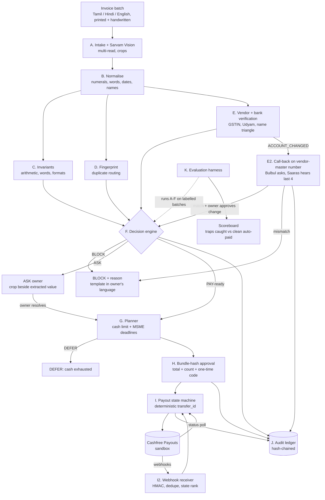
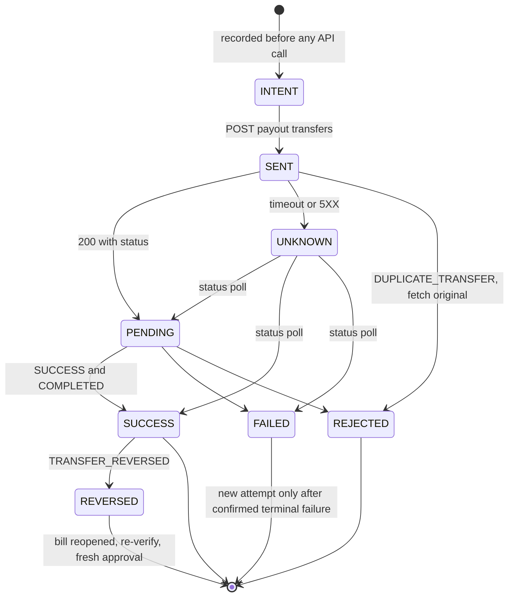
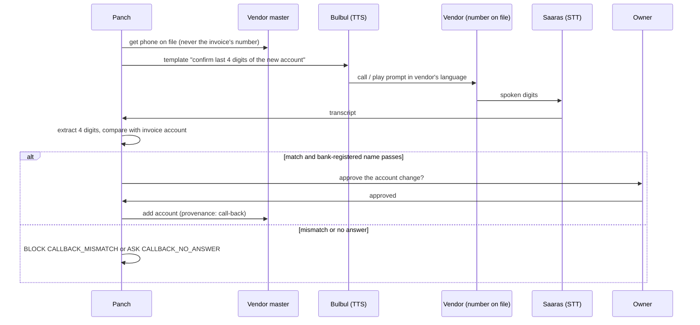
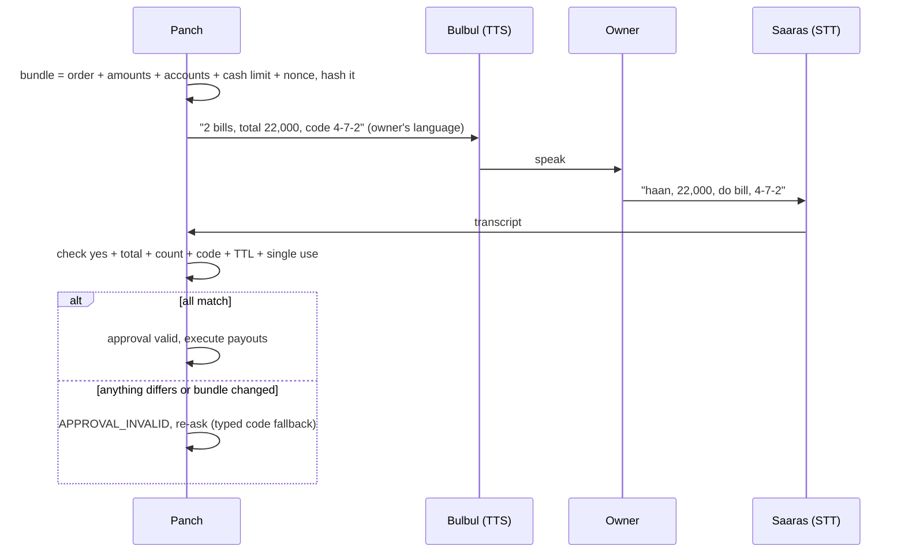

# ARCHITECTURE.md: Panch technical spec (canonical)

Where any other doc disagrees with this one, this one wins. Items marked UNVERIFIED have not been confirmed in docs or a real run.

## 1. Shape of the system

```
                 invoice batch (images/PDFs)
                            |
        [A] intake + Sarvam Vision (multi-read, crops)
                            |
        [B] normalisation (numerals, words, dates, names)
                            |
        [C] invariants (arithmetic, words, formats)   ----+
        [D] fingerprint + duplicate routing           ----+--> [F] decision engine
        [E] vendor + bank verification + quarantine   ----+     PAY / ASK / BLOCK / DEFER
                            |                                  (+ reason code, template)
                 [E2] vendor call-back (old number) <-- ASK: ACCOUNT_CHANGED
                            |
        [G] planner (cash limit, deadlines)  [thin]
                            |
        [H] bundle-hash approval (voice + typed fallback)
                            |
        [I] payout execution + webhook state machine
                            |
        [J] audit ledger (hash-chained) [thin]

   [K] evaluation harness runs A..F on labelled batches -> scoreboard
   [L] voice layer   [M] UI   [N] synthetic data   [O] platform adapter (FastAPI / Relay)
```

### Flow diagram (Mermaid)



### Payout state machine (Mermaid)



### Vendor call-back on the old number (Mermaid)



### Bundle approval (Mermaid)



### Mandatory core (never cut)
1. Invariants that are true by construction (section C).
2. Economic fingerprint with duplicate routing (section D).
3. Bank verification with our own name match, and changed-account quarantine (section E).
4. One real sandbox payout through the idempotent state machine (section I).
5. Clean-control measurement in the scoreboard (section K).

### Thin layers (build small, cut first)
- Planner regret table (G), hash-chained audit viewer (J), spoken digits in approval (H; keep a button).

## 2. Modules

### A. Intake and reading (Sarvam Vision)
- SDK: `sarvamai` 0.1.48, `client.document_intelligence.create_job(...)` → `job.upload_file(path)` → `job.start()` → `job.wait_until_complete()` → `job.download_output(path)` (names read from the installed SDK; output format and field schema UNVERIFIED, test early).
- Latency is 20-90 s per job and handwriting accuracy is unverified. **Never block the live demo on Vision**: pre-run the demo batch and cache the output; start new files in the background the moment they arrive.
- **Multi-read:** read each document from the original and two preprocessed variants (binarised, upscaled). A field is `stable` only if the reads agree after normalisation. Unstable fields set `LOW_CONFIDENCE_READ` and route to ASK. Never pick a "best guess" silently.
- Keep a crop (bounding box) per field if Vision returns layout; otherwise keep the page image and the raw text span (UNVERIFIED whether bounding boxes are returned).

### B. Normalisation (pure functions)
- Numerals: Tamil (U+0BE6-U+0BEF), Devanagari (U+0966-U+096F) and Latin digits to ASCII. Traditional Tamil numerals (௰ 10, ௱ 100, ௲ 1000) flagged, not parsed silently.
- Amounts: strip currency symbols and "/-"; Indian grouping `1,25,000`; "lakh"/"crore" in English, Hindi (लाख, करोड़) and Tamil (லட்சம், கோடி). Result is `Decimal`.
- Amount in words: English, Hindi and Tamil number words to `Decimal` (Tamil and Hindi word lists need native-speaker review).
- Dates: `dd-mm-yyyy`, `dd/mm/yy`, `d Mon yyyy`, `yyyy-mm-dd`, `3rd November 2026`, Tamil and Hindi month names. Default day-first (India). If day and month are both ≤ 12 and the format is unknown, mark the date `ambiguous`.
- Vendor names: lowercase, strip honorifics and legal suffixes (sri, shri, m/s, traders, & co, pvt ltd), transliterate to Latin, then a phonetic key. Keep the original string too.
- Invoice numbers: strip prefixes, separators, leading zeros and case.

### C. Invariants (pure functions)
True-by-construction checks. A failure here is a **BLOCK**.
| Code | Check |
|---|---|
| `ARITH_LINE` | each line: quantity x rate = amount (tolerance 1 paisa per line) |
| `ARITH_SUBTOTAL` | sum of lines = subtotal |
| `ARITH_TOTAL` | subtotal + tax = total |
| `ARITH_WORDS` | amount in words = total in figures |
| `BANK_INVALID` | bank verification says `account_status` INVALID |
| `NAME_MISMATCH` | bank-registered name vs claimed payee fails our match (section E) |
| `ACCOUNT_SHARED` | the same account appears under two different vendors in the vendor master |

Soft checks (flag and ASK, never BLOCK on their own): GSTIN checksum/format (Cashfree's published test GSTINs may not pass a real checksum: e.g. `27ABCFGH5678D1Z` has a malformed PAN segment, so a hard block would false-block sandbox data), IFSC format, implausible dates, tax rate not in the configured slab list (confirm current GST slabs before configuring).

### D. Fingerprint and duplicate routing
- Fingerprint = (normalised vendor key, multiset of (item key, quantity, rate), total, invoice date, delivery/PO reference if present).
- Score a new invoice against paid and pending invoices of the same vendor.

| Situation | Outcome | Code |
|---|---|---|
| Same vendor, identical line multiset and total, **same** normalised invoice date or same delivery/PO reference (only the number/format changed) | BLOCK | `DUP_EXACT` |
| Same vendor, high similarity but not identical (a line differs, total within 1%, date within 7 days) | ASK | `DUP_FUZZY` |
| Same vendor, identical content, date in a **new period** (≥ 25 days later) and vendor flagged `recurring` | PAY | (none) |
| Similar vendor name but different GSTIN | not a duplicate | (none) |

Fuzzy matches go to ASK, not BLOCK, so the false-block rate survives the unseen batch. Thresholds live in config and are set from the evaluation sweep (section K).

Defence in depth: the payout `transfer_id` is derived from the fingerprint (section I), so a missed exact duplicate collides at Cashfree (`REJECTED` / `DUPLICATE_TRANSFER`, verified in docs). An amount-altered duplicate gets a new ID, so this backstop does not replace section D.

### E. Vendor and bank verification
- **Vendor master** (our memory, "every loop adds mass"): vendor ID, legal name, GSTIN, Udyam number and class, MSME rule flag, written-agreement days, recurring flag, phone on file, known accounts with provenance (onboarding / invoice / call-back) and first-seen date, payment history, call-back history.
- **GSTIN**: `POST /verification/gstin` → `legal_name_of_business`, `gst_in_status`. **Udyam**: `POST /verification/udyam` → `enterprise_type` (micro/small/medium). Sandbox test data exists for both; anything else returns nothing.
- **Bank account**: `POST /verification/bank-account/sync` with `bank_account`, `ifsc` and `name` → `account_status`, `name_at_bank`, `name_match_score`, `name_match_result`. In sandbox the score depends on the name we send to one of three test accounts (see [DEPENDENCIES.md](DEPENDENCIES.md)). **We compute our own name match** (token-sorted, transliteration-aware, initials-aware) against `name_at_bank` and use Cashfree's tier only as evidence. Thresholds: ≥ 85 pass; 60-84 ASK; < 60 `NAME_MISMATCH` BLOCK (tunable).
- **Name triangle:** payee name on the invoice vs GST legal name (or vendor-master legal name) vs `name_at_bank`. All must clear the threshold.
- **Changed account:** the invoice account differs from every known account of a known vendor → `ACCOUNT_CHANGED`, quarantine, ASK. Never auto-pay.
- **`UNVERIFIABLE`:** GSTIN/Udyam not in sandbox data or verification unavailable → ASK, never BLOCK. Disclose canned results in the design note.

### E2. Vendor call-back on the old number
The voice step that catches a trap instead of only confirming one.
1. Trigger: `ACCOUNT_CHANGED` on a known vendor.
2. Use the **phone number from the vendor master**. Never the one printed on the new invoice: an invoice's phone and account agreeing proves nothing, because both came from the sender.
3. Bulbul (vendor's language) asks: "We received an invoice asking for payment to a new account. Please tell us the last four digits of the account you want us to pay."
4. Saaras transcribes; code extracts four digits (handles spoken digits in Tamil, Hindi, English).
5. Compare with the last four digits of the invoice's account.
   - Match, and the bank-registered name passes the triangle → owner approves the **account change** separately; the account is added to the vendor master with provenance `call-back`.
   - Mismatch, refusal or no answer → BLOCK `CALLBACK_MISMATCH` (or ASK `CALLBACK_NO_ANSWER`).
6. Every call-back is recorded in the audit ledger (transcript, audio hash, result).
- Residual risk (state it): the vendor's own phone could be compromised. In the demo, the "vendor" is a teammate; via a Relay voice call if Relay is used, otherwise browser voice.

### F. Decision engine
Evaluation order (first match wins for BLOCK; ASKs accumulate):
1. Any invariant failure (section C) → **BLOCK**.
2. `DUP_EXACT` → **BLOCK**. `CALLBACK_MISMATCH` → **BLOCK**.
3. `DUP_FUZZY`, `ACCOUNT_CHANGED` (before call-back), `LOW_CONFIDENCE_READ`, `VENDOR_UNVERIFIABLE`, new vendor, amount over the per-invoice limit, soft-check flags → **ASK**.
4. Otherwise **PAY-ready**; the planner may turn it into **DEFER** (`CASH_DEFERRED`).

Every decision stores: outcome, reason codes, evidence (values compared, crops), message key per language.

**When the agent pays on its own:** never without a bundle approval. "Auto" means the invoice enters the proposed bundle without a question; the owner still approves the bundle once.

### G. Planner (thin)
- Inputs: cash limit, PAY-ready invoices with amount, due date, `msme_rule_applies` flag, written-agreement days.
- Deadline: invoice/acceptance date + 15 days (no agreement) or + agreed days capped at 45; only if the flag is set (micro/small, Udyam-registered; not medium or traders).
- Objective (exact subset search; a weekly batch is small, cap the search and fall back to greedy-by-deadline-then-value beyond ~25 candidates): maximise rupees of deduction protected (invoices whose deadline falls before the next payment run), then early-payment discount value, then oldest due date.
- Output: chosen bundle, deferred list with reasons, and a short regret table (the naive earliest-deadline-first plan and what it protects).
- Worked example (hand-checked): cash Rs 30,000; H Rs 4,000 (1 day left), A Rs 12,400 (3 days), B Rs 18,000 (5 days), C Rs 9,600 (no deadline). Subsets under 30,000 among the deadline items: H+A = 16,400; H+B = 22,000; A+B = 30,400 (over). Best is **H+B = Rs 22,000 protected**. Naive earliest-deadline-first pays H, A, then C = Rs 26,000 and protects Rs 16,400.

### H. Bundle-hash approval
- Bundle = ordered list of (invoice ID, beneficiary ID, account hash, amount) + cash limit + creation time + one-time nonce. `bundle_hash` = SHA-256 of the canonical JSON.
- Any change (an amount, an account, the order, the cash limit) produces a new hash; the old approval is invalid.
- Bulbul reads, in the owner's language: number of bills, total and a 3-digit one-time code derived from `bundle_hash` and the nonce. Example: "Do bill, kul 22,000 rupaye. Haan boliye aur code bataiye: 4-7-2."
- The owner says yes, the total, the count and the code. Saaras transcribes; code checks all four. TTL 2 minutes; single use.
- Fails on: replay (old nonce), wrong plan (hash mismatch), expired TTL, ambiguous speech ("haan... nahi"), "haan" without the code or total.
- Changed-account items need their own approval of the account change (E2) before they can enter a bundle.
- Typed fallback: the same code typed into the UI. Honest limit: no speaker verification; a voice clone remains a risk.

### I. Payout execution and state machine
- Calls (REST via httpx; the `cashfree_pg` SDK covers PG only, not Payouts or Verification): `POST /payout/beneficiary` (only `VERIFIED` beneficiaries can be paid), `POST /payout/transfers`, `GET /payout/transfers?transfer_id=`. Headers `x-client-id`, `x-client-secret`, `x-api-version: 2024-01-01`. Sandbox host conflict: `sandbox.cashfree.com/payout` (most v2 pages) vs `payout-gamma.cashfree.com` (v1 and some v2 pages); use whichever our credentials work against.
- `transfer_id` = `pn_` + first 32 hex characters of SHA-256(vendor ID | fingerprint | account | amount | attempt). Length 35 for attempt 1 (max 40, alphanumeric and underscore). Store the full digest; check for collisions.

States:
```
INTENT ──send──> SENT ──200 + status──> PENDING ──> SUCCESS (status_code COMPLETED)
                  │                        │──────> FAILED / REJECTED
                  │ timeout / 5XX / no body│
                  └────────> UNKNOWN ──status check──> (any state above)
SUCCESS ──TRANSFER_REVERSED──> REVERSED ──> bill reopened (re-verify + new approval)
```
| Rule | Detail |
|---|---|
| Record before sending | write `INTENT` with the `transfer_id` before the API call |
| UNKNOWN is not FAILED | on timeout/5XX, mark `UNKNOWN`; poll `GET /payout/transfers` with backoff; never resend while UNKNOWN |
| Retry only from terminal failure | a new attempt (attempt + 1, new `transfer_id`) only after the status API confirms FAILED/REJECTED and not `DUPLICATE_TRANSFER`; within the same approved bundle |
| Success is final only when | status SUCCESS and `status_code` COMPLETED (`SENT_TO_BENEFICIARY` is not final) |
| Reversal | `REVERSED` reopens the bill as unpaid; it goes back through E (re-verify) and needs a fresh bundle approval; never auto-repay |
| Duplicate response | `REJECTED` + `DUPLICATE_TRANSFER` means "already sent"; fetch status of the original, do not create a new attempt |

### I2. Webhook receiver
- `POST /webhooks/cashfree/payouts`. Verify `x-webhook-signature` = base64(HMAC-SHA256(client_secret, `x-webhook-timestamp` + raw body)) on the **raw** body. This matches `Cashfree.PGVerifyWebhookSignature` in the installed `cashfree_pg` SDK (no separator). Docs conflict for some products, so test against a real delivery.
- Events: `TRANSFER_ACKNOWLEDGED`, `TRANSFER_SUCCESS`, `TRANSFER_FAILED`, `TRANSFER_REVERSED`, `TRANSFER_REJECTED`, plus `LOW_BALANCE_ALERT`, `BENEFICIARY_INCIDENT`.
- Deduplicate by (`cf_transfer_id`, `status`, `event_time`). Apply by state rank (INTENT 0 < SENT/UNKNOWN 1 < PENDING 2 < SUCCESS/FAILED/REJECTED 3 < REVERSED 4); a lower-rank event after a higher one is logged and ignored. If unsure, poll status.
- Delivery stops after more than five failures (docs), so always reconcile by polling too.

### J. Audit ledger (thin)
Append-only table; each entry = (ID, time, actor, action, payload, `prev_hash`, `hash`). Entries for: invoice ingested (image hash), field reads, each check, decision, call-back, bundle created, approval, payout attempt, webhook event, status poll. The auditor view walks from a payout back to the invoice crop.

### K. Evaluation harness (scoreboard)
See [UNIT_TESTS.md](UNIT_TESTS.md) section 3. Two headline numbers: **traps caught (BLOCK)** and **clean auto-paid rate**. ASK on a clean invoice counts as a **false hold**. Claim only "zero false blocks on our clean controls, measured", never on the unseen batch.

### L. Voice layer
- STT: `client.speech_to_text.transcribe(file=..., model="saaras:v4", mode="codemix", language_code=..., keyterms=[vendor names])`. The installed SDK docstring says `mode` is "only applicable when using saaras:v3" while also listing all modes for v4: test both.
- TTS: `client.text_to_speech.convert(text=..., language_code=..., model="bulbul:v4-flash", speaker=...)`, returns base64 audio. v4-flash default speaker `shubh_enhi_ads`; persona IDs are `<name>_<language>_<style>`. Max 2,500 characters. **Write numbers above four digits with commas** (e.g. "22,000") for correct pronunciation.
- Languages for the demo: Tamil (owner), Hindi/Hinglish, English. Check the Bulbul v4-flash language list (11 languages per the docs: hi, en, bn, gu, kn, mr, pa, ta, te, ml, od).
- All text from templates: `templates/<lang>/<message_key>.txt` with variables. Native-speaker review before the demo.

### M. UI (web)
Owner view (batch table with outcome chips and reasons in his language; plan and approval; live payout status via server-sent events), audit view, scoreboard view, side-by-side crop vs extracted value for ASK items.

### N. Synthetic data
- Generator renders invoices (Tamil, Hindi, English; printed and handwriting-style fonts) with planted traps, from a YAML/JSON spec.
- Bind vendors to Cashfree test data. Only three bank-verification test accounts exist (JOHN DOE, TOM WELLS, BOB HOPE); vendor-master `account_holder_name` uses those names, and the name we send controls the tier. Other vendors use a disclosed local fixture. Payout accounts come from the Payouts test table (success, pending, failure, reversal).

### O. Platform adapter
- **Now:** FastAPI app exposing the endpoints below; ngrok (or a hotspot) for webhooks.
- **If Relay is required:** a Relay agent triggers on an inbound webhook or schedule, calls our endpoints via HTTP actions (keys in secret properties), and uses Sarvam actions for the live call; our deterministic core is unchanged. Custom logic can move to Lambda only if the desk requires it.

## 3. Internal API (proposed)

| Method | Path | Purpose |
|---|---|---|
| POST | `/batches` | upload invoice files; starts reading in the background |
| GET | `/batches/{id}` | invoices with fields, checks, decisions |
| POST | `/batches/{id}/plan` | build a bundle under a cash limit |
| POST | `/vendors/{id}/callback` | start the old-number call-back |
| POST | `/vendors/{id}/callback/result` | submit call-back audio/transcript |
| POST | `/bundles/{id}/approve` | submit approval audio or typed code |
| POST | `/bundles/{id}/execute` | create payouts for an approved bundle |
| POST | `/webhooks/cashfree/payouts` | Cashfree payout webhooks |
| GET | `/payouts/{transfer_id}` | state and history |
| GET | `/audit/{entity_id}` | audit chain |
| GET | `/scoreboard` | evaluation results |
| GET | `/events` | server-sent events for the UI |

## 4. Data model (SQLite is enough)

- `vendor(id, legal_name, gstin, udyam, enterprise_type, msme_rule_applies, agreement_days, recurring, phone_on_file, account_holder_name)`
- `vendor_account(id, vendor_id, account_hash, last4, ifsc, provenance, first_seen, status)`
- `invoice(id, batch_id, image_hash, vendor_id, number_raw, number_norm, date, date_ambiguous, subtotal, tax, total, words_amount, payee_name, account_last4, account_hash, fingerprint)`
- `line_item(invoice_id, item_key, qty, rate, amount)`
- `field_read(invoice_id, field, value, variant, stable, crop_ref)`
- `check_result(invoice_id, code, passed, severity, evidence_json)`
- `decision(invoice_id, outcome, codes, message_key)`
- `callback(id, vendor_id, invoice_id, phone_used, spoken_last4, result, transcript, audio_hash)`
- `bundle(id, hash, nonce, cash_limit, created_at, expires_at, status)` and `bundle_item(bundle_id, position, invoice_id, beneficiary_id, amount)`
- `approval(bundle_id, channel, transcript, code_ok, total_ok, count_ok, at)`
- `payout_attempt(transfer_id, invoice_id, bundle_id, attempt, state, cf_transfer_id, status_code, utr, updated_at)`
- `webhook_event(id, type, cf_transfer_id, status, event_time, raw_hash, applied)`
- `audit(id, at, actor, action, payload_json, prev_hash, hash)`

Never store full account numbers in logs; keep them encrypted or only in the beneficiary record; display last four.

## 5. Reason codes

| Code | Outcome | Meaning |
|---|---|---|
| `ARITH_LINE`, `ARITH_SUBTOTAL`, `ARITH_TOTAL`, `ARITH_WORDS` | BLOCK | numbers disagree |
| `DUP_EXACT` | BLOCK | same economic content already paid or pending |
| `DUP_FUZZY` | ASK | looks like a repeat but not identical |
| `BANK_INVALID` | BLOCK | account invalid at bank |
| `NAME_MISMATCH` | BLOCK | bank-registered name does not match the vendor |
| `ACCOUNT_SHARED` | BLOCK | one account under two vendors |
| `ACCOUNT_CHANGED` | ASK | new account on a known vendor (quarantine) |
| `CALLBACK_MISMATCH` | BLOCK | vendor's spoken last four differ |
| `CALLBACK_NO_ANSWER` | ASK | call-back not completed |
| `VENDOR_UNVERIFIABLE` | ASK | GST/Udyam not verifiable in sandbox |
| `LOW_CONFIDENCE_READ` | ASK | reads unstable or ambiguous |
| `GSTIN_FORMAT`, `IFSC_FORMAT`, `DATE_IMPLAUSIBLE`, `TAX_RATE` | ASK | soft-check flags |
| `OVER_LIMIT` | ASK | above per-invoice limit |
| `CASH_DEFERRED` | DEFER | clean, no cash left this run |
| `APPROVAL_INVALID` | (bundle) | hash, code, TTL or speech check failed |

## 6. Proposed repo layout (not yet created)

```
app/                 FastAPI app, routes, SSE, webhook endpoints
panch/
  reading/           Vision client, multi-read, crops
  normalise/         numerals, amounts, words, dates, names
  checks/            invariants and soft checks (pure)
  fingerprint/       fingerprint + duplicate routing (pure)
  vendors/           vendor master, verification client, call-back flow
  decide/            decision engine (pure)
  planner/           cash/deadline planner (pure)
  approval/          bundle hash, nonce, code, speech check
  payouts/           Cashfree Payouts client, state machine, webhook handling
  cashfree/          shared HTTP client, auth headers, signature verification
  voice/             Saaras/Bulbul wrappers, templates loader
  audit/             hash-chained ledger
  eval/              mutation generator, scoreboard
templates/{ta,hi,en}/  message templates
config/              thresholds, cash limit, vendor flags
data/fixtures/       vendor master, GST/Udyam fixtures, labelled batches
data/synthetic/      generator specs (outputs git-ignored except the small demo batch)
scripts/             generate_batch.py, smoke_payout.py, run_eval.py
tests/unit/  tests/integration/  tests/contract/
```

## 7. Shared interfaces (agree before coding)

Each PR codes against these. Change them only by a small PR to `main` that everyone pulls.

```python
# panch/models.py  (owned by PR 2; others import it)
from dataclasses import dataclass, field
from datetime import date
from decimal import Decimal
from enum import Enum
from typing import Literal, Optional

class Outcome(str, Enum):
    PAY = "PAY"; ASK = "ASK"; BLOCK = "BLOCK"; DEFER = "DEFER"

@dataclass(frozen=True)
class CheckResult:
    code: str                                  # e.g. "ARITH_TOTAL"
    passed: bool
    severity: Literal["block", "ask", "info"]
    evidence: dict                             # values compared, crop refs
    message_key: str                           # templates/<lang>/<key>.txt

@dataclass(frozen=True)
class LineItem:
    item_key: str; qty: Decimal; rate: Decimal; amount: Decimal

@dataclass
class Invoice:
    id: str
    source_hash: str                           # hash of the image/PDF
    vendor_name_raw: str
    vendor_key: str                            # phonetic key
    gstin: Optional[str]
    number_raw: Optional[str]; number_norm: Optional[str]
    date: Optional[date]; date_ambiguous: bool
    lines: list[LineItem]
    subtotal: Optional[Decimal]; tax: Optional[Decimal]; total: Optional[Decimal]
    words_amount: Optional[Decimal]
    payee_name: Optional[str]
    account_number: Optional[str]              # in memory only; never logged
    ifsc: Optional[str]
    stable: dict[str, bool] = field(default_factory=dict)  # per-field multi-read agreement

@dataclass
class Decision:
    invoice_id: str
    outcome: Outcome
    codes: list[str]
    checks: list[CheckResult]
```

| Function | Module (PR) | Pure? |
|---|---|---|
| `parse_amount(text) -> Decimal \| None`, `words_to_amount(text, lang) -> Decimal \| None`, `parse_date(text) -> tuple[date \| None, bool]`, `vendor_key(name) -> str`, `norm_invoice_number(text) -> str` | `panch/normalise` (PR 1) | yes |
| `read_invoice(path) -> Invoice` (Vision + multi-read) | `panch/reading` (PR 1) | no |
| `run_invariants(inv, cfg) -> list[CheckResult]` | `panch/checks` (PR 2) | yes |
| `fingerprint(inv) -> str`, `route_duplicates(inv, history, vendor) -> list[CheckResult]` | `panch/fingerprint` (PR 2) | yes |
| `decide(inv, checks) -> Decision` | `panch/decide` (PR 2) | yes |
| `name_score(a, b) -> int`, `verify_vendor(inv, vendor, client) -> list[CheckResult]` | `panch/vendors` (PR 3) | score pure; verify does I/O |
| `transfer_id(vendor_id, fp, account, amount, attempt) -> str`, `apply_event(state, event) -> state` | `panch/payouts` (PR 3) | yes |
| `PayoutsClient.create_beneficiary/transfer/get_status`, `VerificationClient.bank/gstin/udyam` | `panch/cashfree` (PR 3) | no |
| `verify_signature(secret, timestamp, raw_body, signature) -> bool` | `panch/cashfree` (PR 3) | yes |
| `render(message_key, lang, **vars) -> str`, `speak(text, lang) -> bytes`, `transcribe(audio, lang, keyterms) -> str`, `extract_digits(transcript, lang) -> str` | `panch/voice` (PR 4) | render/extract pure |
| `make_bundle(items, cash_limit, now) -> Bundle`, `check_approval(bundle, transcript_or_code, now) -> ApprovalResult` | `panch/approval` (PR 4) | yes |
| `start_callback(vendor, invoice) -> CallbackSession`, `finish_callback(session, transcript) -> CheckResult` | `panch/vendors/callback.py` (PR 4) | finish is pure |
| `plan(items, cash, today) -> Plan` | `panch/planner` (Krish) | yes |
| `append(action, payload) -> AuditEntry`, `verify_chain() -> bool` | `panch/audit` (Krish) | no |
